<div align="center">

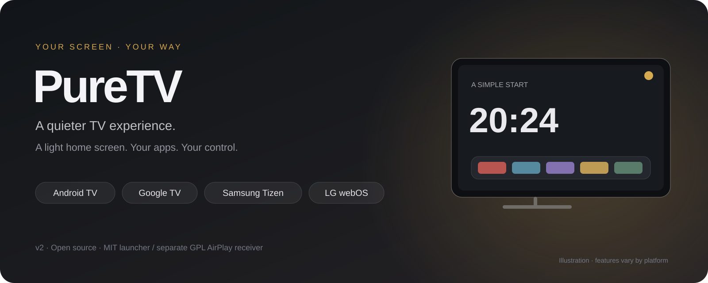

**A calm home screen for your TV, built around your apps.**

[**Download PureTV.apk**](https://github.com/Heymez0/PureTV/releases/latest/download/PureTV.apk) &nbsp;·&nbsp; [Install guide](docs/INSTALL.md) &nbsp;·&nbsp; [What's new](https://github.com/Heymez0/PureTV/releases/latest) &nbsp;·&nbsp; [Turkish guide](docs/README.tr.md)

<sub>v1.4.2 · Android TV & Google TV (Android 9+) · LG webOS & Samsung Tizen (experimental) · 24 languages · open source</sub>

</div>

<br>

<p align="center">
  <a href="docs/media/home-en.png">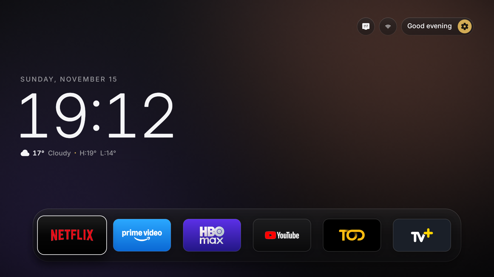</a>
</p>

PureTV replaces the busy, ad-filled home screen of Android TVs and streaming sticks with a quiet one: your apps, the
time and the weather, and nothing you didn't ask for. It is a small native app — about 1.7 MB on its own — that stays
quick on a 1 GB stick, and every screen is made for the remote.

## Highlights

<table>
  <tr>
    <td width="50%" valign="top">
      <h4>🍿 What to watch next, up front</h4>
      Recently watched and Recommended tabs bring your streaming apps' own picks to the home screen as big artwork
      cards, and the background takes its colours from them. OK opens the title in its app.
    </td>
    <td width="50%" valign="top">
      <h4>📱 AirPlay, built in</h4>
      Mirror an iPhone, iPad or Mac. The receiver comes inside PureTV.apk, runs only while AirPlay is on, and the TV
      returns home the moment you stop sharing.
    </td>
  </tr>
  <tr>
    <td width="50%" valign="top">
      <h4>🗂 Every app in one place</h4>
      All Apps shows the home screen's apps, the rest and the ones you hid. Hold OK to add an app to the home screen,
      hide it, or bring it back.
    </td>
    <td width="50%" valign="top">
      <h4>🎛 A remote that does what you say</h4>
      The remote's apps button opens All Apps, and Remote button test lets you give other buttons a job. Nothing
      changes until you save; OK, Back and the arrows always stay put.
    </td>
  </tr>
  <tr>
    <td width="50%" valign="top">
      <h4>✨ Quietly beautiful</h4>
      Dark obsidian or light, one gold accent, and a landscape photo behind a glass clock that changes every day and
      after sunset (or the classic colours). A matching screensaver shows your own photos if you like.
    </td>
    <td width="50%" valign="top">
      <h4>⚙️ In control, without the clutter</h4>
      Quick settings for AirPlay, memory and a sleep timer; app lock; backup and restore; updates from this
      repository; and a one-step way back to your TV's original home screen.
    </td>
  </tr>
</table>

<p align="center">
  <a href="docs/media/recommendations-en.png">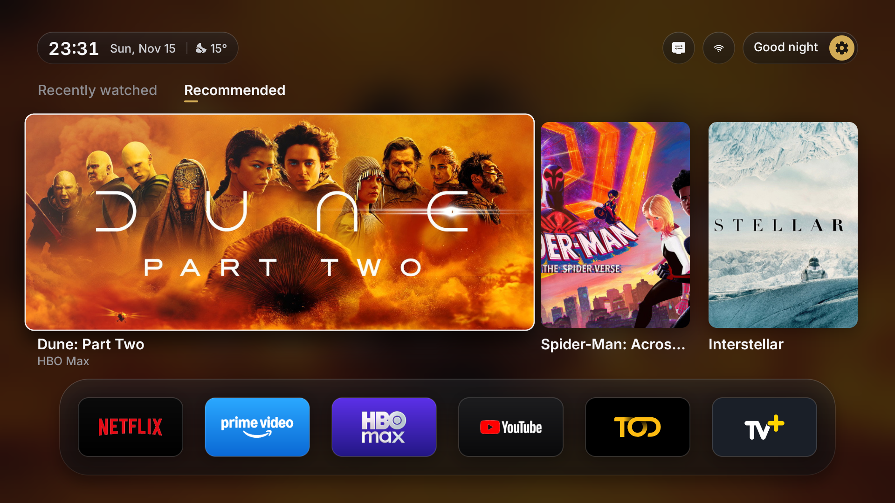</a>
  <br><sub><b>Recently watched and Recommended</b> — what to watch next, straight from the apps you use; OK opens it in the app</sub>
</p>

## A closer look

<table>
  <tr>
    <td width="50%" align="center" valign="top">
      <a href="docs/media/landscape-en.png">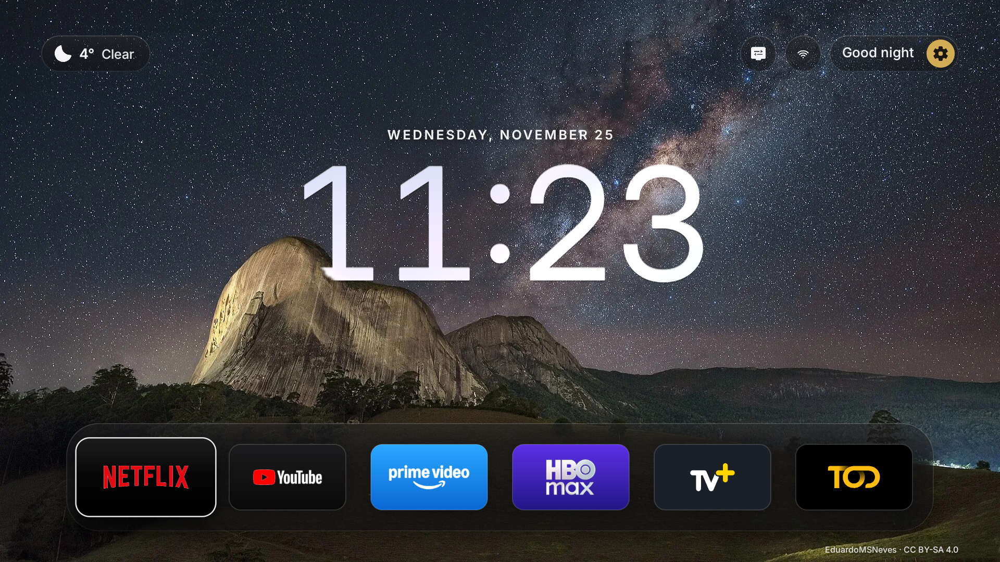</a>
      <br><sub><b>Background photos</b> — a new landscape behind the clock every day</sub>
    </td>
    <td width="50%" align="center" valign="top">
      <a href="docs/media/setup-en.png">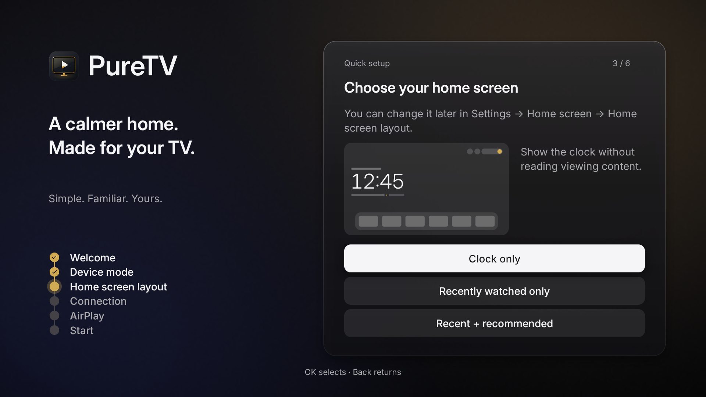</a>
      <br><sub><b>Setup guide</b> — choose your home screen from previews</sub>
    </td>
  </tr>
  <tr>
    <td width="50%" align="center" valign="top">
      <a href="docs/media/settings-en.png">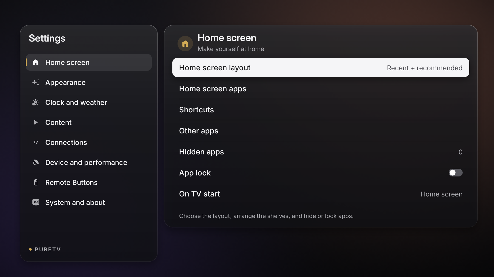</a>
      <br><sub><b>Settings</b> — every setting explained beside it</sub>
    </td>
    <td width="50%" align="center" valign="top">
      <a href="docs/media/quick-settings-en.png">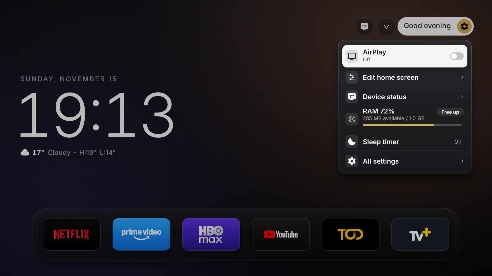</a>
      <br><sub><b>Quick settings</b> — AirPlay, memory and a sleep timer</sub>
    </td>
  </tr>
  <tr>
    <td width="50%" align="center" valign="top">
      <a href="docs/media/shortcuts-en.png">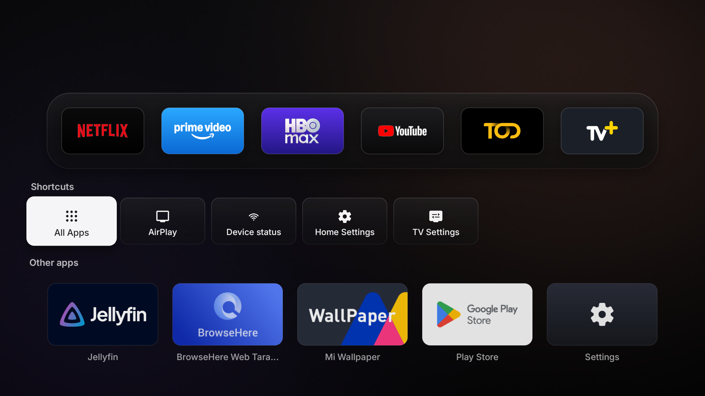</a>
      <br><sub><b>Shortcuts and other apps</b> — one press down</sub>
    </td>
    <td width="50%" align="center" valign="top">
      <a href="docs/media/screensaver-en.png">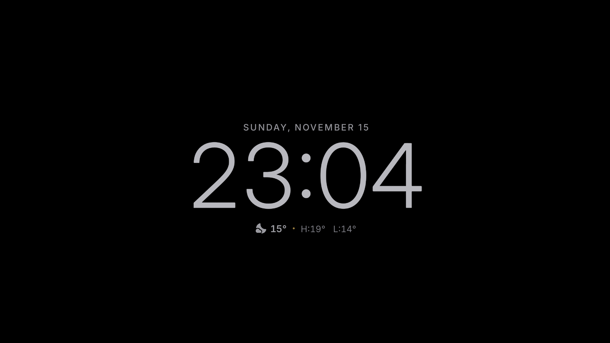</a>
      <br><sub><b>Screensaver</b> — quiet, and kind to the panel</sub>
    </td>
  </tr>
</table>

<p align="center">
  <a href="docs/media/background-en.png">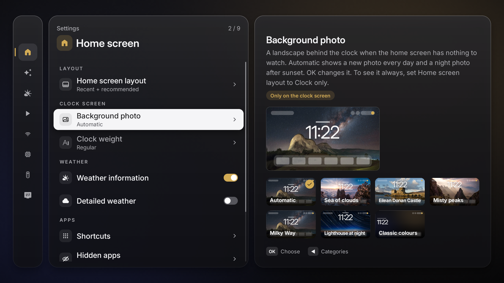</a>
  <br><sub><b>Background photo</b> — a new landscape every day and at night, or the classic colours</sub>
</p>

<p align="center">
  <a href="docs/media/light-en.png">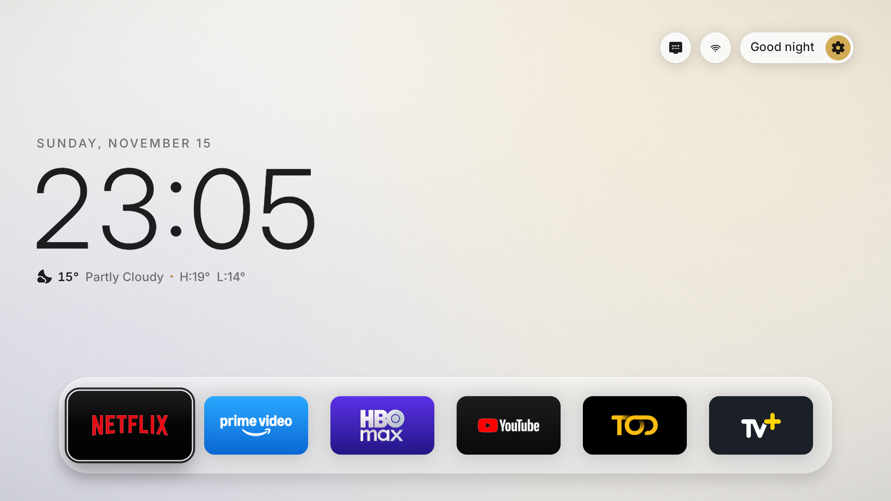</a>
  <br><sub><b>Light theme</b> — or Automatic, by sunrise and sunset</sub>
</p>

<sub>Real screenshots of PureTV v1.4 and v1.4.2 on a Xiaomi Mi Stick (Android TV 9), English interface. Open any image for full size. [About these captures](docs/media/README.md).</sub>

## Install

**Android TV / Google TV** — [download **PureTV.apk**](https://github.com/Heymez0/PureTV/releases/latest/download/PureTV.apk),
copy it to a USB drive or send it to the TV, open it with the TV's file manager, and follow the setup guide.
Already using PureTV? Install it over your version, or use **System and about → Updates**; your settings stay.
[Step-by-step guide](docs/INSTALL.md#android-tv--google-tv).

| Platform | Download | Status |
| --- | --- | --- |
| Android TV · Google TV | **PureTV.apk** | Tested on a Xiaomi Mi Stick (Android TV 9) |
| LG webOS | **PureTV-webos.ipk** · needs Developer Mode | Experimental, not yet tried on a TV — [steps](docs/INSTALL.md#lg-webos) |
| Samsung Tizen | **PureTV-tizen.wgt** · sign with your TV certificate | Experimental, not yet tried on a TV — [steps](docs/INSTALL.md#samsung-tizen) |

Changed your mind? **Settings → System and about → Default home screen → TV's original home screen** brings your TV's
own home screen back, with PureTV still installed.

<details>
<summary><b>Let an assistant install it for you</b></summary>

<br>

With [Claude Code](https://code.claude.com/docs/en/cli-reference) or [Codex CLI](https://learn.chatgpt.com/docs/codex/cli) signed in, run **one** of these in a folder on your computer and keep your TV's model and IP address at hand:

```sh
claude "Install PureTV on my TV from https://github.com/Heymez0/PureTV. Read AGENTS.md and docs/INSTALL.md in that repository, identify my TV platform, ask only for missing device details, then follow the matching installation steps. If an older PureTV is already installed, follow the upgrade steps in docs/INSTALL.md, and keep the original HOME recovery working."
```

```sh
codex "Install PureTV on my TV from https://github.com/Heymez0/PureTV. Read AGENTS.md and docs/INSTALL.md in that repository, identify my TV platform, ask only for missing device details, then follow the matching installation steps. If an older PureTV is already installed, follow the upgrade steps in docs/INSTALL.md, and keep the original HOME recovery working."
```

</details>

## Using it

<p align="center">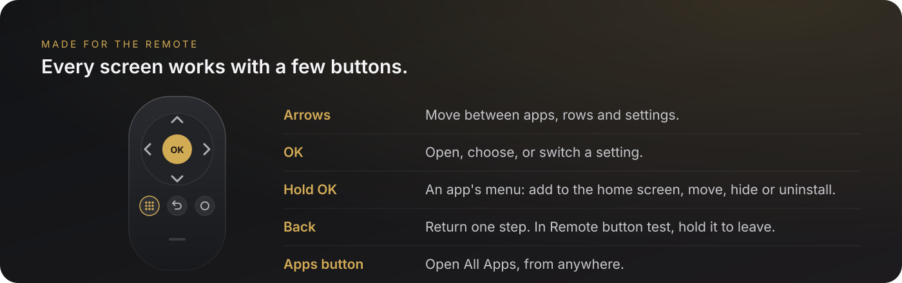</p>

Recently watched and recommendations come from what your installed apps share with Android. PureTV becomes the home
screen through your TV's own USB debugging, without a computer — the setup guide explains each step. LG and Samsung run
a lighter web edition without the Android-only parts (AirPlay, TV inputs, remote buttons).

**Languages:** English, Czech, Danish, Dutch, Finnish, French, German, Greek, Hindi, Indonesian, Italian, Japanese,
Korean, Norwegian Bokmål, Polish, Portuguese, Romanian, Russian, Simplified Chinese, Spanish, Swedish, Turkish,
Ukrainian and Vietnamese.

## For developers

```sh
# Android: Python 3.10+, JDK 17, Android SDK 34
python build.py --config config.example.properties
# LG webOS and Samsung Tizen: Python only (Samsung also needs a signing profile)
python webos/build.py --generic
python tizen/build.py --generic --sign YOUR_PROFILE
```

```text
app/       Native Android launcher (Java, Canvas; no libraries)
web/       Shared LG / Samsung interface
webos/     LG packaging
tizen/     Samsung packaging
airplay/   The AirPlay receiver's complete source (GPL-3.0)
tools/     Build, translation, tests and audits
docs/      Install, development, licences and media
```

[Development and tests](docs/DEVELOPMENT.md) · [Changelog](docs/CHANGELOG.md) · [Release checks](docs/RELEASE.md) · [Contributing](.github/CONTRIBUTING.md) · [Security](.github/SECURITY.md)

## License

PureTV is [MIT](LICENSE); incorporated code keeps its [third-party notices](docs/licenses/NOTICE.md). The AirPlay
receiver PureTV carries is a separate **GPL-3.0** app; its complete source is in [`airplay/`](airplay), so each
release's Source code archive includes it. App names and logos belong to their owners.
