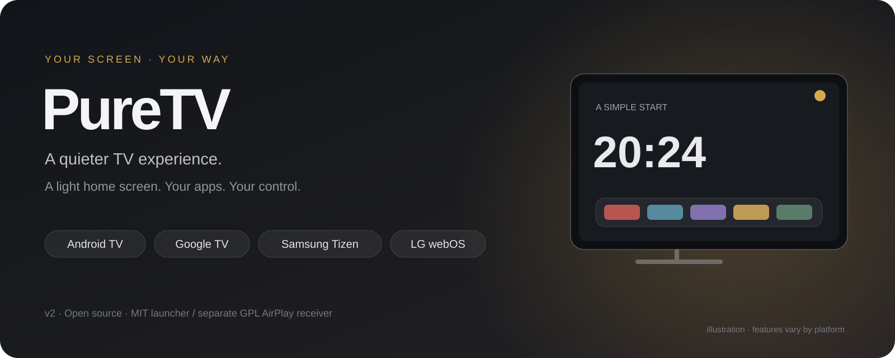
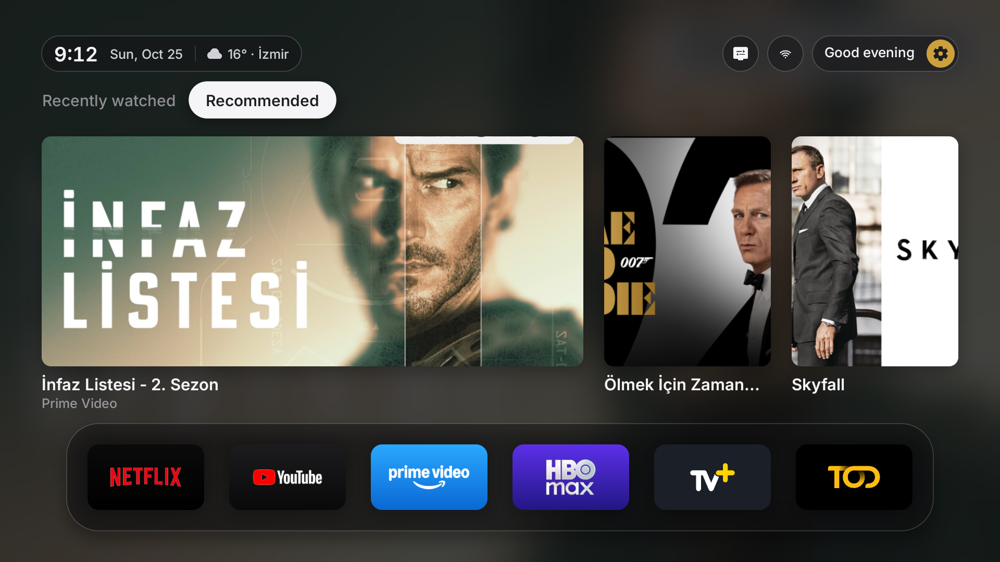
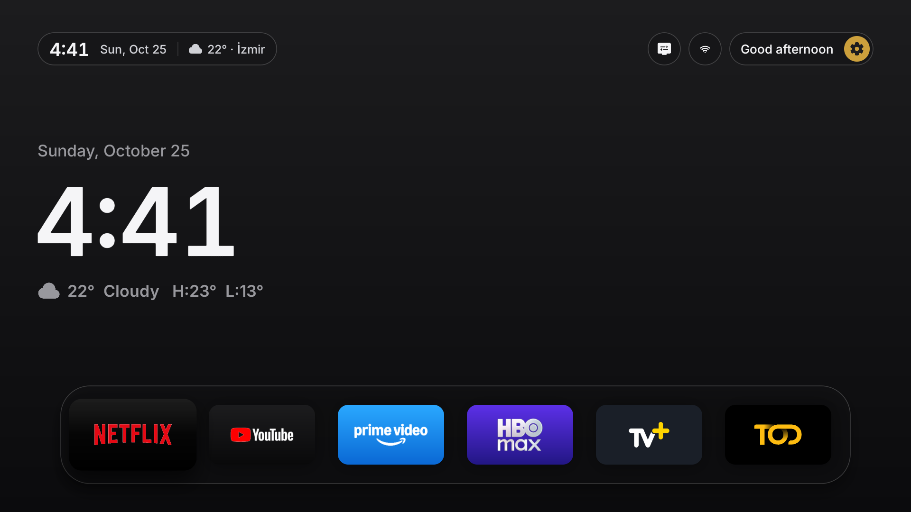
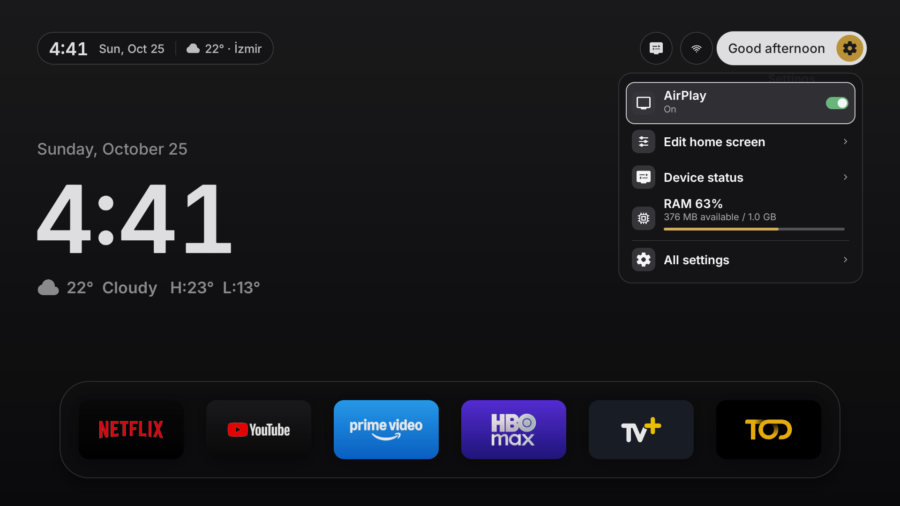
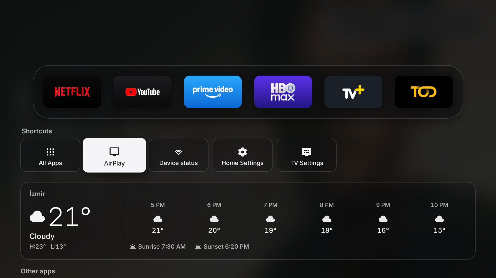
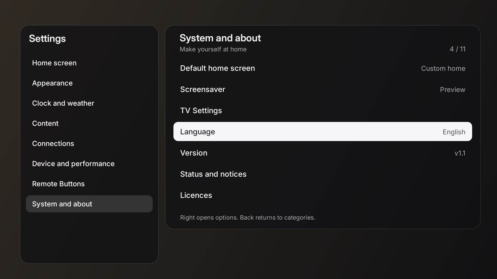

<div align="center">



# PureTV

**A quieter TV home screen, built around your apps.**

[Install](docs/INSTALL.md) · [Turkish guide](docs/README.tr.md) · [Build](docs/DEVELOPMENT.md#build) · [AirPlay](tools/airplay/README.md) · [Changelog](docs/CHANGELOG.md)

</div>

PureTV brings a simple home screen to Android TVs, streaming boxes and sticks.
A native Java/Canvas launcher runs on Android; LG and Samsung use a lightweight web app.

**Hardware testing is limited to the Android TV / Google TV edition.** The reference device is a Xiaomi Mi Stick
running Android TV 9. **LG webOS and Samsung Tizen are experimental ports and have not been tested on real TV hardware.**

## Features

- **Choose your home:** a clock, recent content, or recent content with app recommendations.
- **Keep apps within reach:** separate app and shortcut shelves, other apps below, and long-press shelf reordering.
- **Make it yours:** light/dark themes, weather, 12/24-hour time and a plain black screensaver.
- **Stay in control:** compact quick settings, optional lightweight mode and on-demand RAM/storage snapshots.
- **Use your TV:** box/stick and TV profiles, available TV inputs and remote-button settings.
- **Receive AirPlay:** optional separate Android receiver with protected quick-panel on/off control.

Recent content depends on what installed Android apps publish. Optional web catalogue cards use your own TMDB key.
Android-specific settings, recent-content providers and AirPlay control are not available in the LG/Samsung web edition.

## Languages

PureTV includes **24 interface language catalogues**: English, Czech, Danish, Dutch, Finnish, French, German,
Greek, Hindi, Indonesian, Italian, Japanese, Korean, Norwegian Bokmål, Polish, Portuguese, Romanian, Russian,
Simplified Chinese, Spanish, Swedish, Turkish, Ukrainian and Vietnamese.

## Preview

Real English-interface screenshots from PureTV v2 on a Xiaomi Mi Stick running Android TV 9.

### Home Screens

<p align="center">
  <a href="docs/media/recommendations-en.png"></a>
  <br><strong>Recent + recommended</strong>
</p>

<p align="center">
  <a href="docs/media/home-en.png"></a>
  <br><strong>Clock home page</strong>
</p>

### Features

<table>
  <tr>
    <td width="33%" align="center" valign="top">
      <a href="docs/media/quick-settings-en.png"></a>
      <br><strong>Quick settings</strong>
    </td>
    <td width="34%" align="center" valign="top">
      <a href="docs/media/shortcuts-en.png"></a>
      <br><strong>Shortcuts</strong>
    </td>
    <td width="33%" align="center" valign="top">
      <a href="docs/media/settings-en.png"></a>
      <br><strong>Settings</strong>
    </td>
  </tr>
</table>

Open any screenshot to see it at full resolution. The combined home shows app-published recommendations;
viewing-history titles and progress are not shown. Recommendation titles and artwork follow the source app's language.
The header banner is an illustration. [Capture details](docs/media/README.md).

## Install

**Android TV / Google TV:** [Download PureTV.apk](https://github.com/Heymez0/PureTV/releases/download/v2.0.0-preview/PureTV.apk) · [Release and SHA256 checksum](https://github.com/Heymez0/PureTV/releases/tag/v2.0.0-preview)

The signed v2 preview APK is for **Android 9 or newer**. Download it on your computer, copy it to a USB drive or
transfer it to the TV, then open it with the TV file manager. Follow PureTV's welcome guide after installation.
[Step-by-step Android instructions](docs/INSTALL.md#android-tv--google-tv).

PureTV is currently private: sign in to GitHub with repository access to view source and download files.

### Easy to install

With [Claude Code](https://code.claude.com/docs/en/cli-reference) or [Codex CLI](https://learn.chatgpt.com/docs/codex/cli) installed and signed in, run **one** of these commands in a folder on your computer.

**Claude Code**

```sh
claude "Install PureTV on my TV from https://github.com/Heymez0/PureTV. Read the repository AGENTS.md and docs/INSTALL.md, identify my TV platform, ask only for missing device details, then follow the matching installation steps and preserve the original HOME recovery."
```

**Codex**

```sh
codex "Install PureTV on my TV from https://github.com/Heymez0/PureTV. Read the repository AGENTS.md and docs/INSTALL.md, identify my TV platform, ask only for missing device details, then follow the matching installation steps and preserve the original HOME recovery."
```

Each line starts an interactive installation assistant. Have your TV model/platform and local IP address ready.
Developer Mode, device authorization and any required signing follow the platform guide below.
LG/Samsung ports remain experimental and hardware-untested.

### Choose your platform

| Platform | What to install | Instructions |
| --- | --- | --- |
| Android TV / Google TV | Signed **PureTV.apk**, by USB/file transfer or ADB | [Download and setup](docs/INSTALL.md#android-tv--google-tv) |
| LG webOS | Build an **IPK**; Developer Mode is required | [LG steps](docs/INSTALL.md#lg-webos) · experimental, hardware-untested |
| Samsung Tizen | Build and sign a **WGT** with your TV certificate | [Samsung steps](docs/INSTALL.md#samsung-tizen) · experimental, hardware-untested |

Android APKs are for Android devices. LG and Samsung use the separate packages listed above.
On Android, the welcome guide lets you choose Box/stick or TV. Use **Original** in All settings → System and about →
Default home screen to return to the manufacturer's HOME before removing an active replacement launcher.
[Updates and package identity](docs/INSTALL.md#identity-and-upgrades) · [Platform testing scope](docs/INSTALL.md#compatibility).

## Build

Android needs Python 3.10+, JDK 17 and Android SDK 34. Web packages need Python only; Samsung installation also needs a signing profile.
Choose the command for your platform:

```sh
python build.py --config config.example.properties
python webos/build.py --generic
python tizen/build.py --generic --sign YOUR_PROFILE
```

The default Android APK is unsigned. [Build, signing and configuration](docs/DEVELOPMENT.md#build).
The signed Android preview is available under [Install](#install). Private keys and personal configuration are excluded.

## Source layout

```text
app/       Native Android launcher and assets
web/       Shared web interface
webos/     LG packaging and installer
tizen/     Samsung packaging and installer
tools/     Build helpers, tests and optional AirPlay integration
docs/      Installation, development, artwork and licences
```

[Contributing](.github/CONTRIBUTING.md) · [Security](.github/SECURITY.md) · [Development and tests](docs/DEVELOPMENT.md)

PureTV contributions are [MIT](LICENSE). Incorporated code retains its [third-party notices](docs/licenses/NOTICE.md).
The optional AirPlay receiver is a separate GPL-3.0 application. App names and logos belong to their owners.
